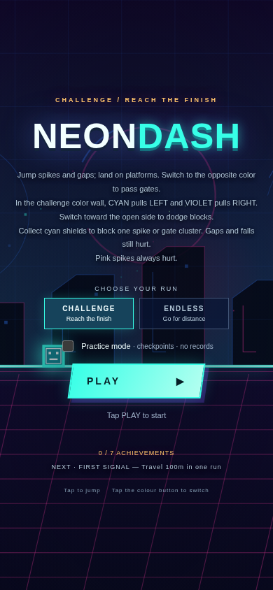
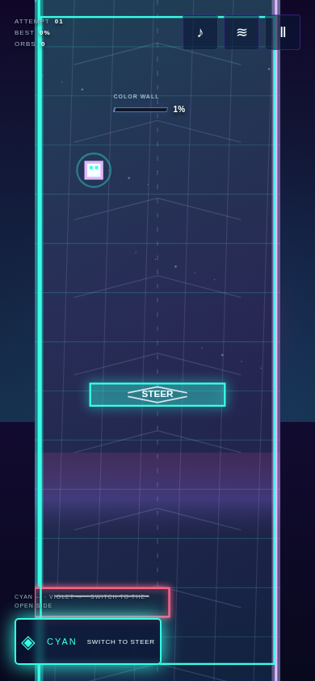

# Neon Dash

[Play Neon Dash](https://aieatassam.github.io/neon-dash/)

Neon Dash is a synthwave one-button platformer about rhythm jumps and color switching. Clear a ~minute **Challenge** to the finish, or push your best distance in **Endless** mode. Jump spikes and gaps, land on platforms, switch phase to pass opposite-color gates, and treat pink spikes as always lethal. Seeded phrases follow the beat as speed rises; orbs, shields, records, and achievements keep each run interesting.

Midway through Challenge, the run **rotates into a vertical color wall**: cyan pulls left, violet pulls right. A glowing portal, slow-mo warp, and in-run tutorial ease the transition; telegraphed gates and a safe runway help first-timers survive the switch. Long gaps vary by seed and hide bonus orbs along stepping-stone jumps.

_Inspired by the one-button rhythm platformer genre and [Geometry Dash](https://geometrydash.fandom.com/wiki/Geometry_Dash) — not affiliated with RobTop Games._

Cyan shield pickups appear along the course. Collect one to absorb a single spike or gate cluster; it does not protect against gaps, falls, or platform impacts. The HUD shows when a shield is ready.

## Controls

- **Space, Up, or W:** jump. Hold to jump again when you land.
- **X or Shift:** switch phase.
- **P or Escape:** pause or resume.
- **Touch screens:** use the on-screen jump and phase controls.

Sound is optional. Supported devices can also provide short haptic feedback; sound and vibration are controlled separately. Records and achievements stay in local browser storage.

Choose **Practice mode** before starting to learn a circuit. During a run, add checkpoints with **+ Checkpoint** and remove the latest with **Undo**. After a crash, you return to the latest checkpoint (or the start if there isn't one). Practice runs don't update records or achievements. Pause and choose **Mode Selection** to leave practice.

## Run locally

Install dependencies with `npm ci`, then run `npm run dev` and open the local address printed by Vite. `npm run build` type-checks and creates the production site in `dist/`; `npm run preview` serves that build locally. No backend is required. The GitHub Actions workflow deploys `dist/` to GitHub Pages.

Run `npm test` for simulation tests and `npm run layout` for the browser layout matrix. After installing Playwright Chromium, `npm run perf` measures three fixed-seed runs at 390×844, DPR 3 and 4× CPU throttling. It records 20 active frame intervals per run after warm-up, keeps incomplete runs visible, and reports the median run mean. Results vary with the host and do not replace physical-device testing; see [performance notes](docs/performance.md).

## Project notes

Neon Dash is an independent project inspired by the broad one-button rhythm-platformer genre and Geometry Dash. It is not affiliated with, endorsed by, or connected to RobTop Games or Geometry Dash. Geometry Dash is a trademark of its respective owner. Vite splits Phaser into a separate engine chunk (about 340 kB gzipped); the game loads it when the page starts. See [RESEARCH.md](RESEARCH.md) for design references and [ATTRIBUTION.md](ATTRIBUTION.md) for music and sound credits. The project source is available under the MIT License; included audio assets retain their own CC0 dedication.

## Media

[Watch a short gameplay clip](docs/media/gameplay.webm)

| Challenge color wall (portrait) | Opening run (portrait) |
| --- | --- |
|  |  |
