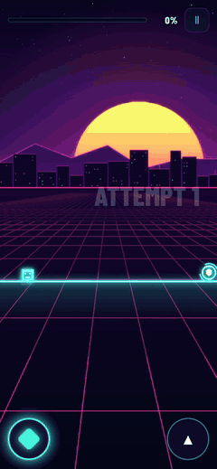
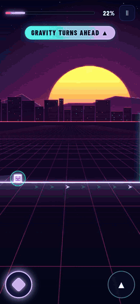
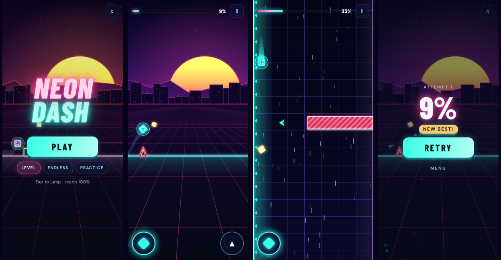
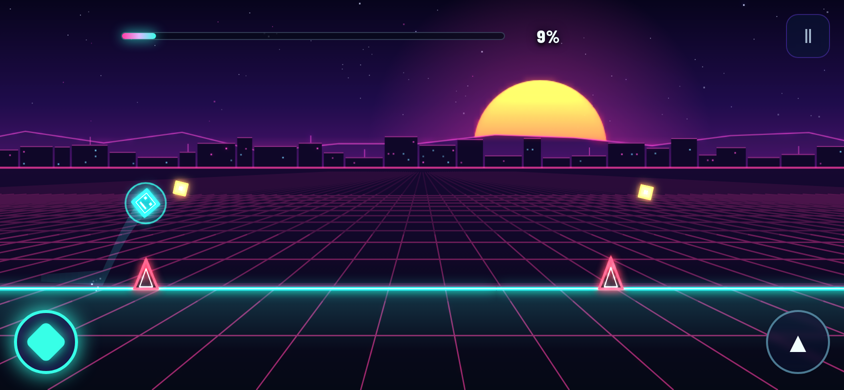
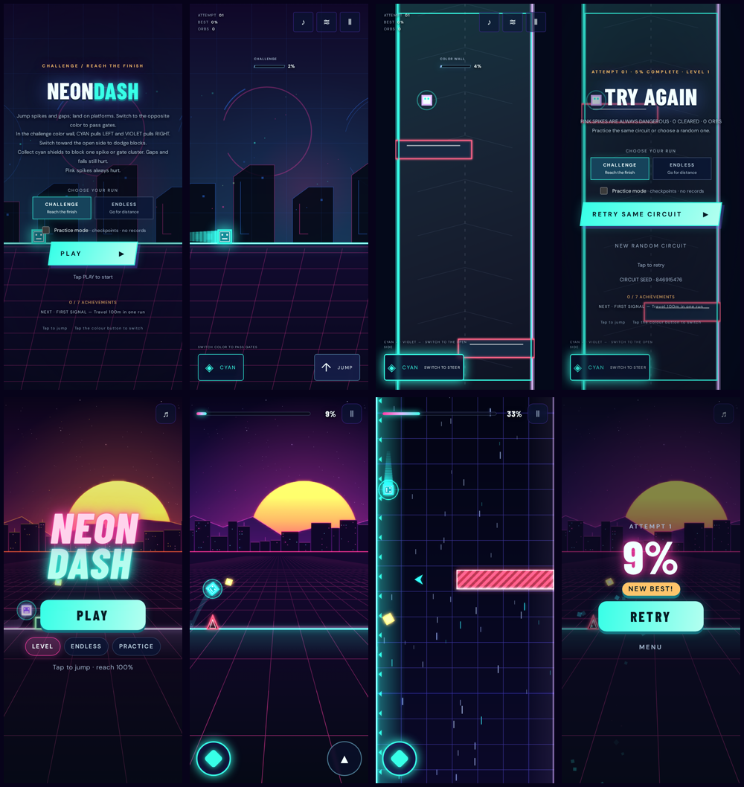

<div align="center">

# NEON DASH

**A one-tap synthwave rhythm runner — with a twist where gravity turns.**

### [▶ Play in your browser](https://aieatassam.github.io/neon-dash/)

Works on phones, tablets and desktops. No install, no account.

 &nbsp; 

</div>

## How to play

Run to the beat. **Tap to jump.** Clear the level to reach 100%.

- **Spikes and pulses:** jump them.
- **Gaps:** jump them.
- **Platforms:** land on top.
- **Color gates:** tap **◈** to switch your color to match the gate, then run through it.
- **Halfway through, gravity turns.** The world rotates and you climb a shaft. **Tap anywhere to swap walls** and dodge the blocks.

A banner warns you five seconds before the turn. The game slows down while it rotates and shows a one-line tip the first time. You then get a few seconds of open runway before the first block.

## Modes

| Mode | What it is |
| --- | --- |
| **Level** | The hand-made course, to 100%. Your best % is saved. |
| **Endless** | A new course every run that keeps speeding up. Beat your best distance. |
| **Practice** | The level with automatic checkpoints. Crash and you're straight back where you were. |

## Controls

| | Touch | Keyboard |
| --- | --- | --- |
| Jump (hold to keep jumping) | Tap the screen or ▲ | Space, Up or W |
| Switch color | ◈ | X or Shift |
| Swap walls in the shaft | Tap anywhere | Space, X or Shift |
| Retry | Tap anywhere on the result | R or Enter |
| Pause | ⏸ | P or Esc |

## Built to feel good

- **Forgiving input.** Coyote time lets you jump just after leaving an edge, a jump buffer remembers a tap made just before you land, and hitboxes are slightly smaller than the art.
- **A gentle start.** The first 20 seconds are single low spikes, each with an orb on its arc, plus a free shield for your first mistake. The game teaches each new thing once, by doing, with one short prompt.
- **Instant retry.** Tap anywhere and you're running again in well under half a second.
- **Neon juice.** Bloom and glow, a ribbon trail, a perspective grid that pulses to the 115 BPM track under a synthwave sun and skyline, and particles on every jump, landing, orb and crash. Screen shake, flashes, a death shatter, and PERFECT and streak popups.
- **Readable hazards.** Red means danger, solid gates block you, dashed gates let you through, and blocks in the shaft are hatched.
- **Phone-first layout.** Tested at 360×640, 390×844, 430×932, 844×390, 932×430 and 1280×800 with automatic overlap checks. Safe areas, haptics and adaptive quality are handled.





## Before and after the overhaul

The top row is the old build and the bottom row is the new one, on a 390×844 phone. Same bots, same level: a sloppy player now survives the first 15 s 96% of the time (was 74%). They get through the first 5 s of the vertical shaft every time (was 6%) and finish the level 60% of the time (was 0%). The full measurements are in the [overhaul analysis](docs/analysis/2026-11-08-overhaul.md).



## Development

```bash
npm ci
npm run dev        # local dev server
npm test           # simulation, generation and bot tests
npm run layout     # Playwright layout, touch and vertical-section checks (six screen sizes)
npm run build      # type-check and build to dist/
npm run perf       # frame-time probe at 390×844, DPR 3, 4× CPU throttle
```

The game is written in TypeScript with [Phaser](https://phaser.io/) running the loop and a custom Canvas 2D renderer, built with [Vite](https://vitejs.dev/). `core.ts` holds a deterministic fixed-step simulation, so every run on a seed is repeatable. GitHub Actions runs the tests and deploys `dist/` to GitHub Pages.

Ghost-input bots play the real simulation:

- `npx tsx scripts/bot-report.mjs` measures how far expert, sloppy and very sloppy players get.
- In the browser, `?autoplay=good` or `?autoplay=sloppy` lets a bot play. Add `&skip=vertical` to jump straight to the shaft.
- `node scripts/record-clips.mjs <url> <dir>` records frame-perfect clips through the same harness.
- `node scripts/capture-states.mjs` takes the menu, gameplay, vertical and result screenshots.

## Credits

Neon Dash is inspired by **[Geometry Dash](https://www.robtopgames.com/)** by RobTop Games, the game that made one-button rhythm platforming a genre, and by the wider synthwave aesthetic. It is an independent fan project and is not affiliated with, endorsed by, or connected to RobTop Games. Geometry Dash is a trademark of its owner.

Music and sound credits are in [ATTRIBUTION.md](ATTRIBUTION.md); design references are in [RESEARCH.md](RESEARCH.md) and [GAME_FEEL_RESEARCH.md](GAME_FEEL_RESEARCH.md).

## License

The code is released under the [MIT License](LICENSE). Included audio assets keep their own CC0 dedication.
