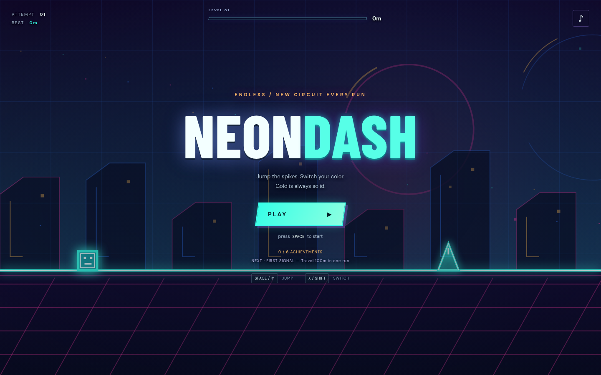

# Neon Dash

[Play Neon Dash](https://aieatassam.github.io/neon-dash/)

A full-screen neon endless runner. Jump over spikes and gaps, land on platforms, switch phase to pass through opposite-color gates, and avoid gold spikes in either phase. Each run generates a new circuit and increases in speed; chase your best distance and unlock achievements.

Use Space, Up, or W to jump; X or Shift switches phase. On touch screens, use the on-screen jump and phase controls. P or Escape pauses. Sound is optional, and supported devices provide short haptic feedback. Records and achievements are saved locally in your browser.

Install dependencies with `npm ci`, then run `npm run dev` and open the local address printed by Vite. Run `npm run build` to type-check and create the production site in `dist/`; `npm run preview` serves that build locally. The build uses relative paths and the included GitHub Actions workflow deploys `dist/` to GitHub Pages. No backend is required.

Run simulation tests with `npm test`. See [RESEARCH.md](RESEARCH.md) and [game feel research](GAME_FEEL_RESEARCH.md) for design references and [ATTRIBUTION.md](ATTRIBUTION.md) for audio credits.

## Screenshot

